# 实验结果

## 1. 实验设置

### 1.1 实验任务与数据

实验围绕设备状态分级和站点状态评估，分析 DAMD-Net 的残差路径与风险检出能力，以及 HSF-Net 的基础设施视图、残差路径、类别权重与连续风险评分。实验还通过风险排序检验模型对高风险记录的优先筛选能力。

设备数据包含 30,000 条设备日记录、5,729 台设备，日期为 2026-02-01 至 2026-02-06；每台设备有 5～6 条记录。站点数据包含 4,000 条站点日记录、77 个站点，日期为 2026-02-01 至 2026-03-24。

状态标签为弱监督规则生成的正常、关注、异常、高危四级标签；第 2、3 类合并为风险正类。站点连续风险评分目标为 0～100 分的弱监督风险分。指标反映对状态评估规则的拟合与跨对象泛化表现。

### 1.2 数据划分

设备按 unified_device_id、站点按 station_id 分组。GroupShuffleSplit 的外层测试比例为 25%，随机种子为 42；其余对象中按组抽取 20% 作为验证集，随机种子为 17。三个分区的对象互不重叠，各消融配置使用相同分区。

| 层级 | 分区 | 对象数 | 日记录数 | 正常 / 关注 / 异常 / 高危 |
| --- | --- | ---: | ---: | --- |
| 设备 | 训练 | 3436 | 17965 | 14404 / 2642 / 733 / 186 |
| 设备 | 验证 | 860 | 4501 | 3596 / 696 / 178 / 31 |
| 设备 | 测试 | 1433 | 7534 | 6000 / 1162 / 289 / 83 |
| 站点 | 训练 | 45 | 2338 | 1899 / 348 / 65 / 26 |
| 站点 | 验证 | 12 | 623 | 478 / 106 / 39 / 0 |
| 站点 | 测试 | 20 | 1039 | 823 / 146 / 56 / 14 |

站点验证分区没有第 3 级样本，因此验证指标对最高风险类的覆盖有限。填补、标准化和 One-Hot 编码仅在训练分区拟合，设备输入为 174 维，站点输入为 49 维。标签在配置间保持一致，分支消融期间不重新计算。

### 1.3 训练参数与评价指标

| 参数 | 取值 |
| --- | --- |
| 运行环境 | Python 3.11.15；PyTorch 2.12.0；CPU |
| 优化器 | AdamW |
| 学习率 | DAMD-Net、HSF-Net：0.0008 |
| weight decay | 0.0002 |
| 批大小 | 256 |
| 最大训练轮数 | 设备 25；站点 25 |
| 权重选择 | 验证集分类交叉熵最小轮次 |
| 训练种子 | 42、43、44 |
| 结果汇总 | 三次训练均值 ± 样本标准差 |
| 分类评价 | Macro-F1、二次加权 Kappa（QWK）和风险召回率 |
| 连续评分评价 | MAE、RMSE，均以 0～100 分为尺度 |

三个训练种子用于衡量初始化与批次顺序的波动，数据划分保持固定。测试集在训练和权重选择完成后评分。结果中的均值差异不等同于统计显著性。

## 2. 训练收敛

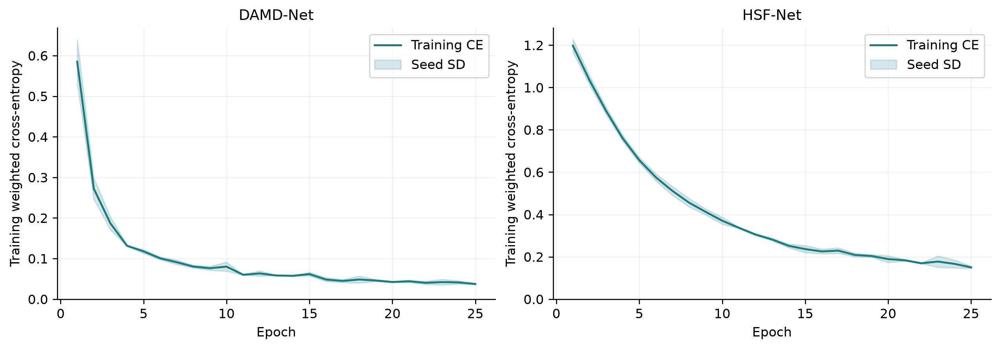

两种模型的训练分类损失随迭代下降，说明网络能够学习多源输入与弱监督状态标签之间的映射。实线为三个种子的训练集加权交叉熵均值，阴影为样本标准差；这些曲线用于观察训练优化过程，泛化能力由测试指标评价。

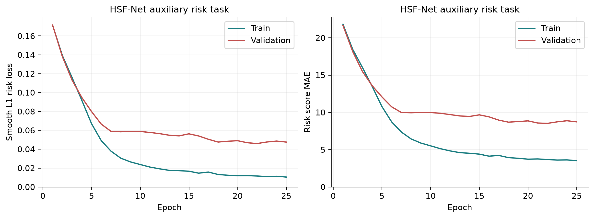

HSF-Net 同时优化状态分类与连续评分，风险 Smooth L1 损失在 0～1 归一化尺度计算，MAE 在 0～100 分尺度报告。训练与验证风险误差随迭代下降，表明辅助风险头能够学习连续风险排序信息；最终权重仍按验证分类交叉熵选择。

## 3. DAMD-Net 关键模块分析

### 3.1 全局残差路径

完整模型将四个专家判别器的门控融合输出与 0.20 倍全输入残差相加。消融配置删除全局残差头，其余专家和训练参数保持一致，并从头训练。

| 配置 | Macro-F1 | QWK | 风险召回率 |
| --- | ---: | ---: | ---: |
| 完整模型 | 0.7935 ± 0.0090 | 0.9029 ± 0.0009 | 0.8907 ± 0.0191 |
| 移除全局残差 | 0.7702 ± 0.0495 | 0.8940 ± 0.0217 | 0.8826 ± 0.0198 |

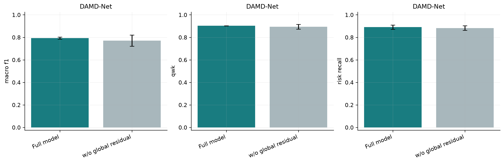

保留全局残差后，Macro-F1 提高 2.33 个百分点，QWK 提高 0.89 个百分点。残差路径为专家融合提供全局特征补充，有助于保持状态分级的一致性。

### 3.2 类别权重与风险检出

该实验以少数风险类召回为评价目标，对照类别加权交叉熵与普通交叉熵，检验类别权重对风险检出的作用。

| 配置 | 风险召回率 |
| --- | ---: |
| 完整模型 | 0.8907 ± 0.0191 |
| 移除类别权重 | 0.7724 ± 0.0296 |

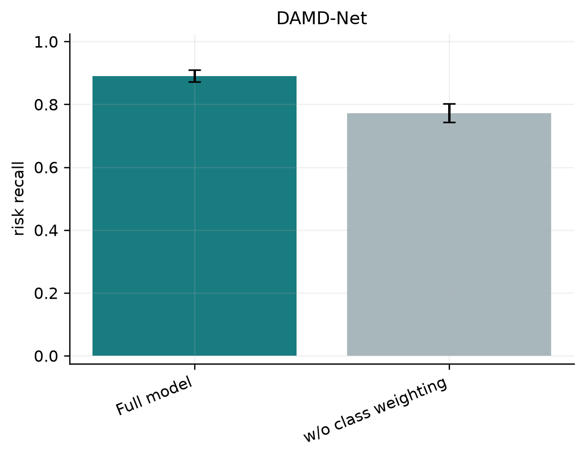

类别加权后的风险召回率为 0.8907 ± 0.0191，比无类别权重配置提高 11.83 个百分点，支持在少数类风险筛查任务中采用类别权重。该结论限定于风险召回，不表示所有分类指标或误报表现均提升。

## 4. HSF-Net 关键模块分析

### 4.1 基础设施视图、全局残差与类别权重

分别删除基础设施编码器、全局残差头，以及交叉熵类别权重，对照完整 HSF-Net。删除视图时保留其他分支，并将剩余门控权重归一化。

| 配置 | Macro-F1 | QWK | 风险召回率 |
| --- | ---: | ---: | ---: |
| 完整模型 | 0.5804 ± 0.0913 | 0.7990 ± 0.0326 | 0.7286 ± 0.0247 |
| 移除基础设施分支 | 0.4289 ± 0.1504 | 0.6074 ± 0.1160 | 0.2476 ± 0.4166 |
| 移除全局残差 | 0.3149 ± 0.2427 | 0.4839 ± 0.4070 | 0.5000 ± 0.4331 |
| 移除类别权重 | 0.3406 ± 0.0293 | 0.6215 ± 0.0275 | 0.0000 ± 0.0000 |

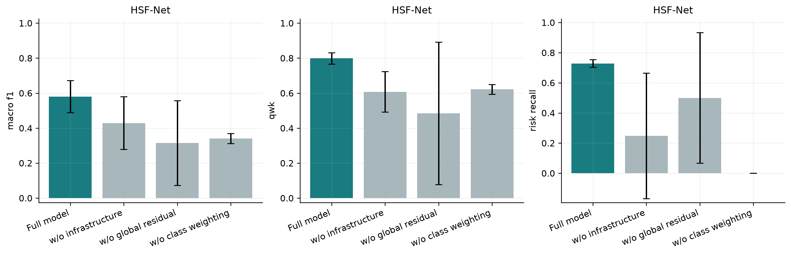

完整模型的 Macro-F1 为 0.5804 ± 0.0913，风险召回为 0.7286 ± 0.0247。移除基础设施分支后，Macro-F1 下降 15.14 个百分点；移除全局残差后下降 26.55 个百分点。去掉类别权重后，三个种子的风险召回均为 0。这些对照说明基础设施专门表示、全局路径和类别权重对当前站点分级任务具有作用。

### 4.2 多视图表示与连续风险评分

通过分别删除运行视图和历史检修视图，分析专门编码器对连续风险分回归的作用。

| 配置 | 风险分 MAE | 风险分 RMSE |
| --- | ---: | ---: |
| 完整模型 | 9.71 ± 1.65 | 11.93 ± 2.11 |
| 移除运行分支 | 11.71 ± 0.75 | 14.02 ± 0.23 |
| 移除历史检修分支 | 15.98 ± 1.47 | 19.91 ± 1.68 |

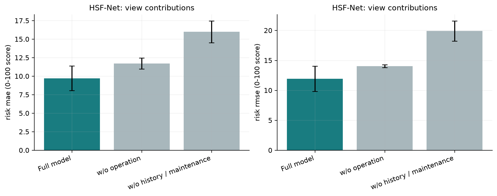

完整模型的 MAE 为 9.71 ± 1.65 分，RMSE 为 11.93 ± 2.11 分。移除运行视图后 MAE 增至 11.71 分，移除历史检修视图后增至 15.98 分，说明运行和检修信息的专门表示有利于连续风险刻画。

分支消融检验的是专门编码器的结构贡献，全输入门控和残差仍可读取相应特征；它不等同于完全删除对应数据源。删除模块也会改变参数量，结果表示该结构调整的整体效应。

## 5. 风险优先排序实验

将测试记录按模型输出的高风险概率降序排列，分别选取前 5%、10%、20%，统计其中覆盖的风险正类比例。高风险概率为第 2、3 类预测概率之和，标签按相同口径合并。选取比例预先固定，不通过测试标签优化阈值。

| 层级 | 优先选取比例 | 风险覆盖率 | 选中记录风险占比 | 相对随机排序富集倍数 |
| --- | ---: | ---: | ---: | ---: |
| 设备日 | 5% | 0.8172 ± 0.0194 | 0.8064 ± 0.0191 | 16.3311 ± 0.3874 |
| 设备日 | 10% | 0.9749 ± 0.0162 | 0.4810 ± 0.0080 | 9.7413 ± 0.1619 |
| 设备日 | 20% | 1.0000 ± 0.0000 | 0.2468 ± 0.0000 | 4.9993 ± 0.0000 |
| 站点日 | 5% | 0.7381 ± 0.0082 | 0.9936 ± 0.0111 | 14.7477 ± 0.1648 |
| 站点日 | 10% | 0.7429 ± 0.0000 | 0.5000 ± 0.0000 | 7.4214 ± 0.0000 |
| 站点日 | 20% | 0.8571 ± 0.1309 | 0.2885 ± 0.0441 | 4.2816 ± 0.6540 |

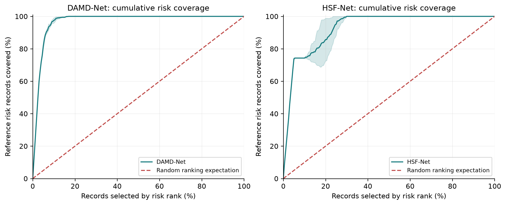

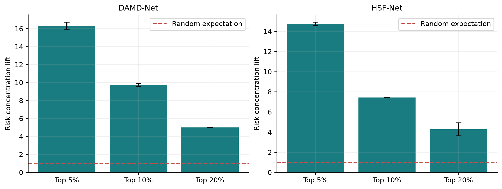

富集倍数定义为“选中记录中的风险占比 / 整体测试集风险占比”。随机排序期望为 1；超过 1 表示模型将风险记录集中到靠前位置。结果支持将模型输出用于风险复核优先级排序。

排序单位为设备日或站点日记录，同一对象不同日期分别计数。这里评价整个离线测试集合的排序效果，不代表去重后的设备巡检覆盖率，也不直接等同于单日告警效果。

## 6. 状态输出与对象差异

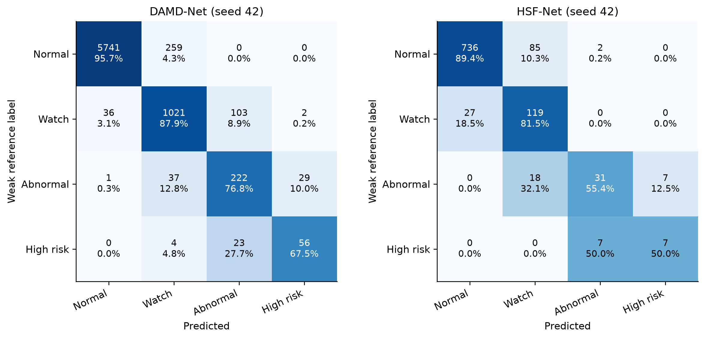

图中使用 seed=42 的完整模型，单元格同时显示数量和按参考类别归一化的比例，用于展示四级状态的识别情况。

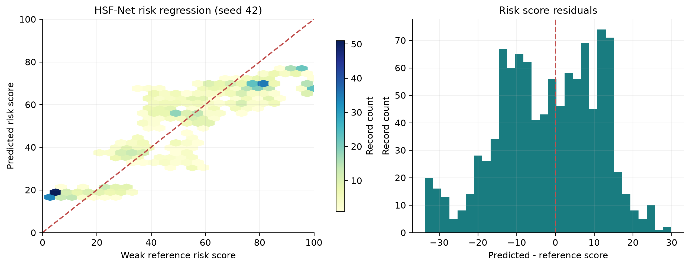

HSF-Net 在四级状态之外输出连续风险分。左图比较预测分与弱监督参考分，右图展示评分残差；参考分不是实际事故概率。

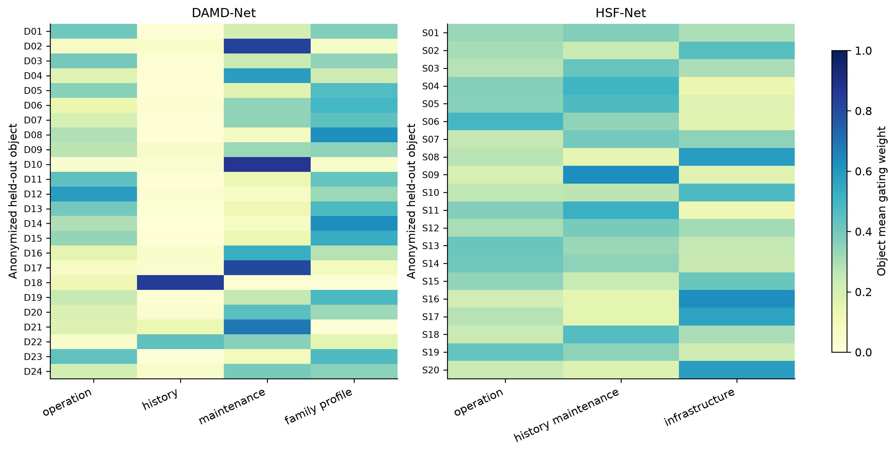

不同对象形成不同的专家或视图组合，体现自适应融合对对象差异的表示能力。权重取测试对象跨日期均值；设备按 ID 排序后等距选取最多 24 台，站点展示全部 20 个测试对象，图中编号为匿名序号。门控权重表示模型内部使用程度，不作为事故原因的因果证据。

## 7. 实验复现

```bash
conda activate griddx
python scripts/run_paper_experiments.py --torch-device cpu --seeds 42 43 44
python scripts/summarize_paper_experiments.py
```

输入为 `outputs/baseline_models/` 下的设备和站点训练特征表。若尚未生成，可执行 `python scripts/run_baseline_pipeline.py --quick --skip-dispatch --torch-device cpu`。

Linux GPU 环境可使用 `--torch-device cuda --gpu-id 0` 指定可见 GPU 编号。运行配置、数据指纹、逐轮指标、模型权重和所有配置的测试结果保存在 `outputs/paper_experiments/`，其中 `risk_ranking_metrics.csv` 保存风险排序实验指标。图片以 PNG 和 SVG 格式保存在 `docs/images/experiments/`。
